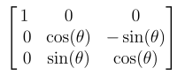
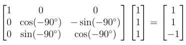

# TerminalCube

TerminalCube (TCube) is an NxNxN Rubik's Cube Simulator that can be used in the terminal with a C++ library for easy use in projects.


To compile:

* Clone the Repository (`git clone https://github.com/Wallball-App/TerminalCube.git`)
* Navigate to the cloned directory
* Configure CMake with `cmake --preset [YOUR_PRESET]`
    * The possible presets are:
        - Windows with Mingw: `windows-mingw`
        - Windows with MSVC (Visual Studio 17 2022): `windows-msvc`
        - MacOS with clang: `macos-clang`
        - Linux with GCC: `linux-gcc`
    * NOTE: A C++ Compiler is Required to Build This Project
* Build the project: `cmake --build build/[YOUR_PRESET]`
* Navigate to `build/[YOUR_PRESET]` to view the generated files

How to Use (App):

- Open tcube.exe
- Enter the cube size (i.e. 3 for the standard Rubik's cube)
- Enter algorithms to execute the moves (e.g. R U R' U')
- Use standard Singmaster Notation (R for Right layer etc.)
- For Larger cubes, use this format: [Layer][Face][Wide][Number][Prime]
Layer is a number less than or equal to half the cube size
Face is the face turned (R, U, F, etc.)
Wide moves should be written with a lowercase "w"
Number is the amount of turns
Prime is shown by the symbol " ' ". If a move is prime, it is rotated counterclockwise instead of clockwise.
Example: 3Rw2'

How to Use (Library):
- Build the project (for instructions see above).
- To compile your program using the library, run the command:
    `g++ [YOUR_PROJECT_SOURCE_FILES] -o [YOUR_OUTPUT_EXECUTABLE_NAME] -lTCube -L path/to/build/[YOUR_PRESET] -I path/to/include/`
- NOTE: If using MSVC on Windows, use this command:
    `cl.exe [YOUR_PROJECT_SOURCE_FILES] /Fe:[YOUR_OUTPUT_EXECUTABLE_NAME] /I path/to/include/ /link /LIBPATH:path/to/build/[YOUR_PRESET] TCube.lib`

If using CMake:
```cmake
add_subdirectory([PATH_TO_CLONED_TCUBE_DIRECTORY])

add_executable(MyProject main.cpp)

target_link_libraries(MyProject PRIVATE TCube)
```
NOTE: Make sure to replace `MyProject` with your project name, `main.cpp` with your source files. The `PRIVATE` keyword can be changed to `PUBLIC` or `INTERFACE` depending on your project's dependencies.

# The Mathematics

TCube uses vectors to represent the pieces on any Rubik's cube.

### The Coordinate System:
Right: +x
Up: +y
Forward: +z

The middle layer (or the layer between the two middle layers on even numbered cubes) will be considered the 'zero-layer'.

NOTE: In a physical even-numbered Rubik's Cube, the 'zero-layer' actually exists under the edges in the center, but it is effectively ignored in this simulation, as it does not change the process in calculating the positions of pieces. 

### Rotation and Piece Movement

Since each piece is represented by a vector, rotating a set of pieces becomes easy due to rotation matrices. When any move is executed, the affected pieces are chosen, and their position vectors will then be multiplied by the rotation matrix.

Example:
Vector: 
$\langle
1, 1, 1
\rangle$
"Right, Top, Front" corner
Move: R (Clockwise rotation around +x axis)

Rotation Matrix: 
<picture>
    <source align="middle" srcset="images/RotationMatrix_Dark.png" media="(prefers-color-scheme: dark)">
    
</picture>

### Multiplication:

$\theta = -90^\circ$ (Because Counterclockwise is usually $+\theta$)

<picture>
    <source align="middle" srcset="images/Solution_Dark.png" media="(prefers-color-scheme: dark)">
    
</picture>

The final vector: 
$\langle
1, 1, 1
\rangle$
represents the "Right, Top, Back" corner, which would be the location of the piece if that move was performed.

### Piece Colors:

The colors of the pieces can also be computed using the same method. Each color on a piece is given a normal vector, indicating the direction it is pointing in. When rotated, this direction vector is multiplied, and the product is the new normal vector. 

A normal vector is a unit vector perpendicular to a surface. 
Ex.
$\langle
0, 0, 1
\rangle$
represents a color that is facing the +Z direction. If this piece is affected by the move shown in the previous sections ("R"), its new normal vector would be: $\langle 0, 1, 0 \rangle$, which points up. 

### Corner Orientation

On any Rubik's Cube, one can assign two colors on opposite sides of a cube to be the main colors used when solving. Usually, these tend to be white and yellow, but they can vary depending on the skill level and preference of the solver. The orientation of a corner depends on the direction in which these pieces are pointing in. 

Corners are assigned a value between 0 and 2, describing their orientation. In a solved cube, every corner will be in the orientation 0, and in every cube that can be solved, the sum of the orientations wil be a multiple of 3. 

### Edge Orientation

Similar to corners, edges (pieces between corners) will also be assigned an orientation based on the main colors. (Also usually white or yellow). However, some edges may not have the main colors on them (e.g. Blue Orange), in which case the main color would be the color of the side facing the solver. 

### Important note on Algorithms

TCube uses both $O(n^2)$ and $O(n^3)$ algorithms to locate pieces (to print or rotate). These algorithms are sometimes time consuming, especially for larger cubes. Please use common sense when simulating a cube, and keep the hardware restrictions of your device in mind. 